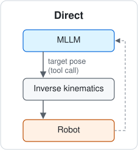
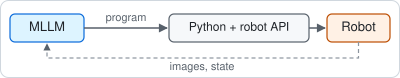

# CleanRUA (Clean Implementations of Robot-Use Agents)

Following the [CleanRL](https://github.com/vwxyzjn/cleanrl) design philosophy, CleanRUA provides single-file, high-quality implementations of robot-use agents for reproducible research. Each code file contains a whole agent, including the prompt, tools, and the interaction loop. The environments are plain Gymnasium environments.


### News
- **[2026/11/21]** Add [delegate_memory_dexjoco.py](cleanrua/delegate_memory_dexjoco.py), which keeps a playbook of lessons per task across episodes. With playbooks learned on other seeds, it succeeded in 10 of 30 test episodes, against 17 for Delegate. Add [code_explore_dexjoco.py](cleanrua/code_explore_dexjoco.py), which learns a task over episodes and compiles it into one program, following RAX; a first pilot did not learn `click_mouse`.
- **[2026/11/20]** Add [DexJoCo](https://github.com/brave-eai/dexjoco), with dexterous Allegro hands, and three agents for it: [delegate_dexjoco.py](cleanrua/delegate_dexjoco.py), [monitor_dexjoco.py](cleanrua/monitor_dexjoco.py) and [code_delegate_dexjoco.py](cleanrua/code_delegate_dexjoco.py). Over 50 episodes on five tasks, Delegate succeeded in 36 and Pi0.5 alone in 28 ([evaluation](https://cleanrua.agentic-intelligence-lab.org/get-started/evaluation/)). [monitor_check_dexjoco.py](cleanrua/monitor_check_dexjoco.py) makes Monitor judge every stretch and correct stalls; it succeeded less often than Monitor.
- **[2026/11/19]** Add two variants of [code_robodojo.py](cleanrua/code_robodojo.py): [code_delegate_robodojo.py](cleanrua/code_delegate_robodojo.py), whose programs can also hand phases to Pi0.5, and [code_jev_robodojo.py](cleanrua/code_jev_robodojo.py), which keeps its whole history and lets Jev drop the parts no longer needed. [direct_jev_robodojo.py](cleanrua/direct_jev_robodojo.py) does the same for Direct.
- **[2026/11/18]** Add [code_robodojo.py](cleanrua/code_robodojo.py) and [monitor_robodojo.py](cleanrua/monitor_robodojo.py), and rename `hybrid_robodojo.py` to [delegate_robodojo.py](cleanrua/delegate_robodojo.py).
- **[2026/11/17]** Add [hybrid_robodojo.py](cleanrua/delegate_robodojo.py) that uses a MLLM moves the robot with motion tools and hands local phases to Pi0.5.
- **[2026/11/16]** Add [direct_robodojo.py](cleanrua/direct_robodojo.py) that uses a MLLM moves the robot with motion tools.

### Get started

Install the dependencies by following the installation guide for [RoboDojo](examples/installation_robodojo.md) or [DexJoCo](examples/installation_dexjoco.md). Then set the model and run an agent:

```sh
export CLEANRUA_MODEL_NAME=YOUR_MODEL
export CLEANRUA_BASE_URL=https://YOUR_PROVIDER/v1
export CLEANRUA_API_KEY=YOUR_API_KEY
python -m cleanrua.direct_robodojo --native-root /path/to/RoboDojo --task stack_bowls
```

Tips:
1. To add a tool, write a `@Tool` method in the agent's wrapper. To change how the agent decides, edit its `RUAgent`.
2. The environment has no tools and no models. Each agent adds them with a `gym.Wrapper`.
3. `finish` only ends the episode. The environment's own check decides success.
4. A variant adds a word to its algorithm's name, such as `code_jev_robodojo.py`, and is still one self-contained file.

### Algorithms implemented

In each diagram, the solid arrows show what the MLLM sends each turn, and the dashed arrow brings camera images and robot state back to it.

| Algorithm | Description | Variants implemented |
|---|---|---|
| Direct | <br>An MLLM moves the arms with motion tools. | [`direct_robodojo.py`](cleanrua/direct_robodojo.py)<br>[`direct_jev_robodojo.py`](cleanrua/direct_jev_robodojo.py) |
| Code | <br>An MLLM writes Python programs that move the arms through a robot API. | [`code_robodojo.py`](cleanrua/code_robodojo.py)<br>[`code_delegate_robodojo.py`](cleanrua/code_delegate_robodojo.py)<br>[`code_jev_robodojo.py`](cleanrua/code_jev_robodojo.py)<br>[`code_delegate_dexjoco.py`](cleanrua/code_delegate_dexjoco.py)<br>[`code_explore_dexjoco.py`](cleanrua/code_explore_dexjoco.py) |
| Delegate | <br>An MLLM gives sub-task instructions to Pi0.5 and can also move the arms itself. | [`delegate_robodojo.py`](cleanrua/delegate_robodojo.py)<br>[`delegate_dexjoco.py`](cleanrua/delegate_dexjoco.py)<br>[`delegate_memory_dexjoco.py`](cleanrua/delegate_memory_dexjoco.py) |
| Monitor | <br>Pi0.5 does the task; an MLLM watches it and corrects failures with motion tools. | [`monitor_robodojo.py`](cleanrua/monitor_robodojo.py)<br>[`monitor_dexjoco.py`](cleanrua/monitor_dexjoco.py)<br>[`monitor_check_dexjoco.py`](cleanrua/monitor_check_dexjoco.py) |

### Cite Us

```bibtex
@misc{cleanrua2026yuan,
  title        = {CleanRUA: Clean Implementations of Robot-Use Agents},
  author       = {Mingqi Yuan, Xudong Wu, Jiayu Chen},
  year         = {2026},
  howpublished = {\url{https://github.com/Agentic-Intelligence-Lab/CleanRUA}},
}
```

### Acknowledgements

CleanRUA is inspired by [CleanRL](https://github.com/vwxyzjn/cleanrl),
[RoboSimStudio](https://github.com/robosimstudio/robosimstudio) and
[uni-robot-agent](https://github.com/Open-RUA/uni-robot-agent). It uses
[RoboDojo](https://github.com/RoboDojo-Benchmark/RoboDojo) and [DexJoCo](https://github.com/brave-eai/dexjoco)
for simulation, and [XPolicyLab](https://github.com/XPolicyLab/XPolicyLab) and DexJoCo's OpenPI server for action
models. We thank their authors.

### License

CleanRUA is released under the [MIT License](LICENSE).
