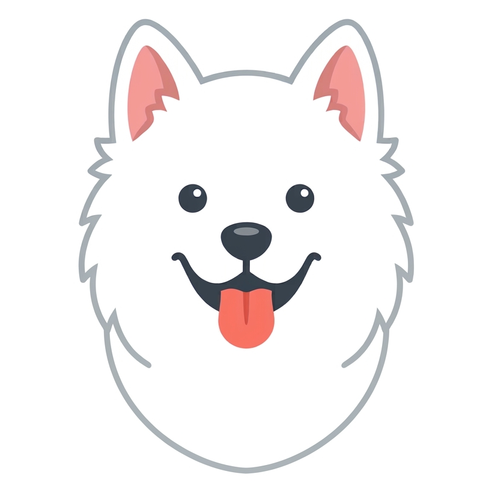

#  CleanRUA

CleanRUA provides clean, single-file implementations of robot-use agents for research.
Inspired by [CleanRL](https://github.com/vwxyzjn/cleanrl), each file keeps an agent's
prompt, tools and interaction loop together, on top of a plain Gymnasium environment.

---
### News
- **[2026/11/16]** 🔥 Hybrid control is available: a vision-language model delegates local phases to Pi0.5 in [hybrid_robodojo.py](cleanrua/hybrid_robodojo.py).
- **[2026/11/16]** 🔥 Direct control is available: a vision-language model drives the robot through motion tools in [direct_robodojo.py](cleanrua/direct_robodojo.py).

### Quick start

Follow the [installation guide](examples/installation.md), then run an agent:

```sh
python -m cleanrua.direct_robodojo --native-root /path/to/RoboDojo --model YOUR_VISION_MODEL
```

| Agent | Idea |
|---|---|
| [direct_robodojo.py](cleanrua/direct_robodojo.py) | A vision-language model controls the robot through motion tools. |
| [hybrid_robodojo.py](cleanrua/hybrid_robodojo.py) | The model also delegates local phases to a vision-language-action model. |

> [!TIP]
> 1. To try your own idea, add a `@Tool` method to an agent's wrapper or change its `RUAgent`.
> 2. Environments are plain `gym.Env`s without tools or models; agents add them with a `gym.Wrapper`.
> 3. A finished tool call is not task success; results report the environment's own verdict.

### Acknowledgements

CleanRUA is inspired by [CleanRL](https://github.com/vwxyzjn/cleanrl),
[RoboSimStudio](https://github.com/robosimstudio/robosimstudio) and
[uni-robot-agent](https://github.com/Open-RUA/uni-robot-agent), and uses
[RoboDojo](https://github.com/RoboDojo-Benchmark/RoboDojo) and
[XPolicyLab](https://github.com/XPolicyLab/XPolicyLab) for simulation and action models.
Thanks to their authors.

### License

CleanRUA is released under the [MIT License](LICENSE).
