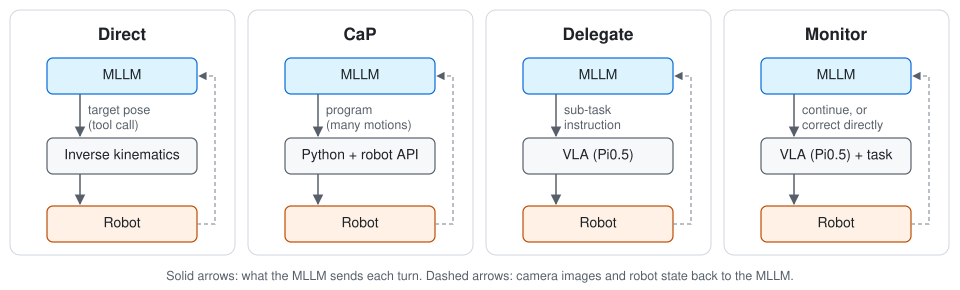

# CleanRUA (Clean Implementations of Robot-Use Agents)

Following the [CleanRL](https://github.com/vwxyzjn/cleanrl) design philosophy, CleanRUA provides single-file, high-quality implementations of robot-use agents for reproducible research. Each code file contains a whole agent, including the prompt, tools, and the interaction loop. The environments are plain Gymnasium environments.


### News
- **[2026/11/18]** Add [code_robodojo.py](cleanrua/code_robodojo.py) and [monitor_robodojo.py](cleanrua/monitor_robodojo.py), and rename `hybrid_robodojo.py` to [delegate_robodojo.py](cleanrua/delegate_robodojo.py).
- **[2026/11/17]** Add [hybrid_robodojo.py](cleanrua/delegate_robodojo.py) that uses a MLLM moves the robot with motion tools and hands local phases to Pi0.5.
- **[2026/11/16]** Add [direct_robodojo.py](cleanrua/direct_robodojo.py) that uses a MLLM moves the robot with motion tools.

### Get started

Install the dependencies by following the [installation guide](examples/installation.md). Then set the model and run an agent:

```sh
export CLEANRUA_MODEL_NAME=YOUR_MODEL
export CLEANRUA_BASE_URL=https://YOUR_PROVIDER/v1
export CLEANRUA_API_KEY=YOUR_API_KEY
python -m cleanrua.direct_robodojo --native-root /path/to/RoboDojo --task stack_bowls
```

Tips:
1. To add a tool, write a `@Tool` method in the agent's wrapper. To change how the agent decides, edit its `RUAgent`.
2. The environment has no tools and no models. Each agent adds them with a `gym.Wrapper`.
3. `finish` only ends the episode. The environment's own check decides success.

### Algorithms implemented



| Algorithm | Description | Variants implemented |
|---|---|---|
| Direct | An MLLM moves the arms with motion tools. | [`direct_robodojo.py`](cleanrua/direct_robodojo.py) |
| Code | An MLLM writes Python programs that move the arms through a robot API. | [`code_robodojo.py`](cleanrua/code_robodojo.py) |
| Delegate | An MLLM gives sub-task instructions to Pi0.5 and can also move the arms itself. | [`delegate_robodojo.py`](cleanrua/delegate_robodojo.py) |
| Monitor | Pi0.5 does the task; an MLLM watches it and corrects failures with motion tools. | [`monitor_robodojo.py`](cleanrua/monitor_robodojo.py) |

### Cite Us

```bibtex
@misc{cleanrua2026yuan,
  title        = {CleanRUA: Clean Implementations of Robot-Use Agents},
  author       = {Mingqi Yuan, Xudong Wu, Jiayu Chen},
  year         = {2026},
  howpublished = {\url{https://github.com/Agentic-Intelligence-Lab/CleanRUA}},
}
```

### Acknowledgements

CleanRUA is inspired by [CleanRL](https://github.com/vwxyzjn/cleanrl),
[RoboSimStudio](https://github.com/robosimstudio/robosimstudio) and
[uni-robot-agent](https://github.com/Open-RUA/uni-robot-agent). It uses
[RoboDojo](https://github.com/RoboDojo-Benchmark/RoboDojo) for simulation and
[XPolicyLab](https://github.com/XPolicyLab/XPolicyLab) for action models. We thank their authors.

### License

CleanRUA is released under the [MIT License](LICENSE).
