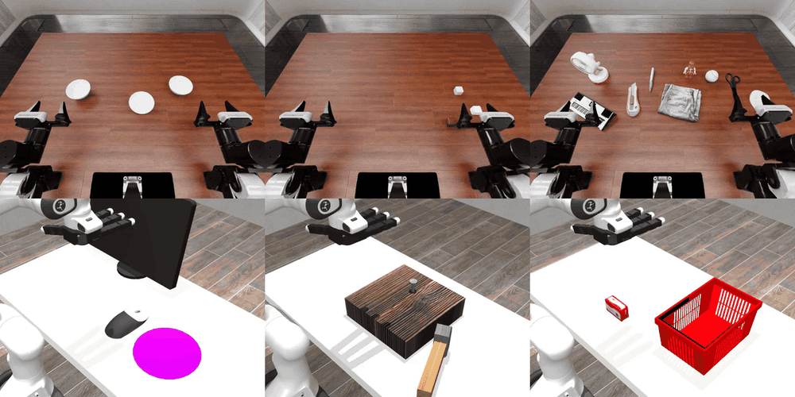
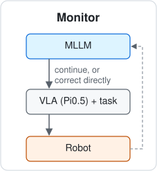

# CleanRUA (Clean Implementations of Robot-Use Agents)

Following the [CleanRL](https://github.com/vwxyzjn/cleanrl) design philosophy, CleanRUA provides single-file, high-quality implementations of robot-use agents for reproducible research. Each code file contains a whole agent, including the prompt, tools, and the interaction loop. The environments are plain Gymnasium environments.



### News
- **[2026/11/25]** Rerun both benchmarks with Qwen4-Max: Monitor did best on RoboDojo (4 of 8 tasks) and DexJoCo (33 of 50 episodes) ([evaluation](https://cleanrua.agentic-intelligence-lab.org/get-started/evaluation/)).
- **[2026/11/23]** Add a prototype of about 100 lines for each paradigm, and move unproven variants to `cleanrua/experimental/`.
- **[2026/11/21]** Add `cap_explore`, which compiles its exploration into one program: 10 of 10 on DexJoCo `click_mouse` with no model calls at test time. Code is renamed CaP.
- **[2026/11/20]** Add [DexJoCo](https://github.com/brave-eai/dexjoco) with dexterous hands. Delegate succeeded in 36 of 50 episodes, Pi0.5 alone in 28 ([evaluation](https://cleanrua.agentic-intelligence-lab.org/get-started/evaluation/)).
- **[2026/11/19]** Add `cap_delegate`, whose programs can call Pi0.5, and history compaction with Jev.
- **[2026/11/18]** Add CaP and Monitor, and rename Hybrid to Delegate.
- **[2026/11/17]** Add Hybrid: an MLLM hands local phases to Pi0.5.
- **[2026/11/16]** Add Direct: an MLLM moves the robot with motion tools.

### Get started

Install the dependencies by following the installation guide for [RoboDojo](examples/installation_robodojo.md) or [DexJoCo](examples/installation_dexjoco.md). Then set the model and run an agent:

```sh
export CLEANRUA_MODEL_NAME=YOUR_MODEL
export CLEANRUA_BASE_URL=https://YOUR_PROVIDER/v1
export CLEANRUA_API_KEY=YOUR_API_KEY
python -m cleanrua.direct_robodojo --native-root /path/to/RoboDojo --task stack_bowls
```

> [!TIP]
> 1. Read a paradigm's prototype first, then its agent for your benchmark.
> 2. To add a tool or change how an agent decides, edit its `@Tool` methods or its `RUAgent`.
> 3. Environments have no tools or models, and their own check decides success.
> 4. Evaluate an agent over several seeds with `cleanrua_utils.benchmark`.

### Algorithms implemented

| Algorithm | Description | Prototype | Variants implemented |
|---|---|---|---|
| Direct | <br>An MLLM moves the arms with motion tools. | [`direct.py`](cleanrua/direct.py) | [`direct_robodojo.py`](cleanrua/direct_robodojo.py) |
| CaP | <br>An MLLM writes Python programs that move the arms through a robot API. | [`cap.py`](cleanrua/cap.py) | [`cap_robodojo.py`](cleanrua/cap_robodojo.py)<br>[`cap_delegate_robodojo.py`](cleanrua/cap_delegate_robodojo.py)<br>[`cap_delegate_dexjoco.py`](cleanrua/cap_delegate_dexjoco.py)<br>[`cap_explore_dexjoco.py`](cleanrua/cap_explore_dexjoco.py) |
| Delegate | <br>An MLLM gives sub-task instructions to Pi0.5 and can also move the arms itself. | [`delegate.py`](cleanrua/delegate.py) | [`delegate_robodojo.py`](cleanrua/delegate_robodojo.py)<br>[`delegate_dexjoco.py`](cleanrua/delegate_dexjoco.py) |
| Monitor | <br>Pi0.5 does the task; an MLLM watches it and corrects failures with motion tools. | [`monitor.py`](cleanrua/monitor.py) | [`monitor_robodojo.py`](cleanrua/monitor_robodojo.py)<br>[`monitor_dexjoco.py`](cleanrua/monitor_dexjoco.py) |

Agents that learn across episodes wrap a paradigm: [`memory.py`](cleanrua/memory.py) is the prototype of carrying lessons from one episode of a task into the next.

### Real-world workstations

All four methods share one launcher. From the repository root, install NumPy, SciPy, Pillow and
httpx in your Python environment and install your station's drivers. Use opencv-python for local
video devices. CaP execution and replay also require Linux, working bubblewrap user namespaces
and NumPy available to `/usr/bin/python3`. Install Gymnasium and Pydantic 2 in the launcher environment
for the shared CaP Explore module.

Create a trusted local station JSON with these fields. Keep calibration and hardware addresses on site.

| Field | Content |
|---|---|
| `env` | Importable `module:Class`. Defaults to `realworld.envs.franka_env:FrankaEnv`. |
| `arms` | Object keyed by `left` and/or `right`. Each Franka profile has `driver` (an importable `module:Class`), constructor `args`, and `end_effector` set to `gripper`. |
| Per-arm calibration | `workspace_m` is `[[xmin,ymin,zmin],[xmax,ymax,zmax]]` in that arm's **base frame**. Set positive `max_translation_m` and `max_rotation_rad` per step before enabling motion. Arrival tolerances default to 0.002 m and 0.05 rad. |
| `station_T_base` (inside each arm) | Pose of the arm base in the station frame, as XYZ metres and fixed-axis XYZ roll/pitch/yaw radians. Single-arm default is identity. With two arms supply both measured transforms. |
| `tool` (inside an arm) | Optional separate gripper driver with `driver` and `args`. Otherwise the arm driver supplies the gripper. |
| `cameras` | Object from camera names to local video indices/device paths or RGB driver specs with `driver` and `args`. Drivers provide `read()` (fresh RGB uint8 H×W×3) and `close()`. |
| `coordinator` | Optional dual-arm driver spec. Its constructor receives the open arm drivers as `arms`. Its blocking `move_poses({arm: base_pose, ...})` plans and executes both TCPs together. It must implement `stop()`. |

The Franka driver supplies `state()` with measured base-frame TCP `pose`, seven `joints` and normalized
`gripper` opening (0 closed, 1 open), blocking `move_pose(base_pose)`, `set_gripper(opening)`, and
`stop()`. A separate gripper supplies its own state, set and stop methods. A site planner such as
cuRoboV2-Fast supplies the calibrated tool model, trajectory validation and collision checking,
including the other arm for independent moves. The environment checks the configured TCP bounds,
step limits and measured arrival. Configuration and resource cleanup belong to the driver
(`close()` is called when provided).

Start with the read-only check. It saves named RGB images, measured arm states and configured limits.
For model runs, set `CLEANRUA_BASE_URL` (including the API version), `CLEANRUA_MODEL_NAME` and
`CLEANRUA_API_KEY` for a vision and tool-capable Chat Completions endpoint.

```bash
python -m realworld direct --config station.json --check
python -m realworld direct --config station.json --enable-motion --task "Stack the blocks"
python -m realworld cap --config station.json --enable-motion --task "Stack the blocks"
python -m realworld delegate --config station.json --policy-config policy.json --enable-motion --task "Stack the blocks"
python -m realworld monitor --config station.json --policy-config policy.json --enable-motion --task "Stack the blocks"
```

Optional station-local `camera_calibration` entries are keyed by camera name. Each carries RGB
`intrinsics` (width, height, k, d, distortion_model) and, when calibrated, `camera_T_reference`
with a named `reference_frame`. This matrix maps reference-frame points into optical coordinates.
Calibration is available to the model and CaP via `state["camera_calibration"]`.

The four methods accept the same model options. For the upstream Qwen4-Max configuration, add
`--model qwen4-max --reasoning-effort xhigh --tool-choice auto` to any model run. Use the base URL
and API key for the provider serving that model. Flags override `CLEANRUA_MODEL_NAME`,
`CLEANRUA_REASONING_EFFORT` and `CLEANRUA_TOOL_CHOICE`. Without an effort setting, the endpoint uses
its own default. The default tool choice is `required`. A text-only response prompts up to two further
requests before the episode stops. CaP uses the selected model for exploration and controller generation.
The offline controller compiler accepts the same flags. Replay and the read-only check require no model.

Each observation has `images[camera]` and `state["arms"][arm]`. A move (or one VLA action)
uses `{"targets": [{"arm": "right", "pose": [x, y, z, roll, pitch, yaw]}]}` in the station frame.
Omitting `gripper` preserves its opening. A dual-arm station accepts either arm independently.
Two targets in one call require a coordinator. Both poses are checked before dispatch, then both
arrivals are checked before optional gripper commands are sent individually. A hardware fault
stops the devices and disables further commands in that session.

Delegate and Monitor take a trusted `policy.json` with `driver` and `args`. The driver is callable
or provides `predict(observation, instruction)`, returning a chunk of actions. Existing single-arm
policies may still return `(pose, opening)` pairs (station frame). Delegate supplies the phase
instruction and Monitor supplies the original task.

CaP uses the same CaP Explore episode, agent, notes and Python compiler as DexJoCo. By default
`notes.md`, the candidate `controller.py`, and `status.json` are written to the run directory.
Pass `--memory-dir PATH` to keep learning one task across runs. On subsequent learning runs Explore
**executes the existing controller first**, includes its feedback and notes in exploration, then
updates the candidate. The physical scene continues in place. Franka supplies live RGB and measured
TCP state; its environment reports task success as unknown. A model's finish or a completed replay
does not promote a controller to verified.

After reviewing the program, run it once with a fresh Python namespace and zero model calls:

```bash
python -m realworld cap --config station.json --enable-motion --replay PATH/controller.py
```

To retry a failed compilation without opening the station, run
`python -m realworld.cap --run-dir RUN_DIR`. It uses the saved compiler input and final RGB frames
and writes the recovered notes and candidate in that run directory.

To use another embodiment, select its ENV in `env`. It is a context manager constructed as
`Env(config, enable_motion=...)` with JSON-serializable `capabilities` (including `arms` and
`max_targets`), `observe()`, `state()`, `ik(targets=...)` and `step(action)`. An empty IK
path signals a rejected goal. The environment owns dispatch, limits, feedback and cleanup.

### Cite Us

```bibtex
@misc{cleanrua2026yuan,
  title        = {CleanRUA: Clean Implementations of Robot-Use Agents},
  author       = {Mingqi Yuan, Xudong Wu, Jiayu Chen},
  year         = {2026},
  howpublished = {\url{https://github.com/Agentic-Intelligence-Lab/CleanRUA}},
}
```

### Acknowledgements

CleanRUA builds on many open projects, listed in [ACKNOWLEDGEMENTS.md](ACKNOWLEDGEMENTS.md). We thank their authors.

### License

CleanRUA is released under the [MIT License](LICENSE).
