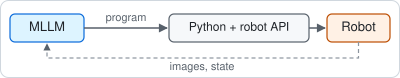
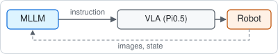

# CleanRUA (Clean Implementations of Robot-Use Agents)

Following the [CleanRL](https://github.com/vwxyzjn/cleanrl) design philosophy, CleanRUA provides single-file, high-quality implementations of robot-use agents for reproducible research. Each code file contains a whole agent, including the prompt, tools, and the interaction loop. The environments are plain Gymnasium environments.


### News
- **[2026/11/23]** Add a prototype of about 100 lines for each paradigm, and move unproven variants to `cleanrua/experimental/`.
- **[2026/11/21]** Add `cap_explore`, which compiles its exploration into one program: 10 of 10 on DexJoCo `click_mouse` with no model calls at test time. Code is renamed CaP.
- **[2026/11/20]** Add [DexJoCo](https://github.com/brave-eai/dexjoco) with dexterous hands. Delegate succeeded in 36 of 50 episodes, Pi0.5 alone in 28 ([evaluation](https://cleanrua.agentic-intelligence-lab.org/get-started/evaluation/)).
- **[2026/11/19]** Add `cap_delegate`, whose programs can call Pi0.5, and history compaction with Jev.
- **[2026/11/18]** Add CaP and Monitor, and rename Hybrid to Delegate.
- **[2026/11/17]** Add Hybrid: an MLLM hands local phases to Pi0.5.
- **[2026/11/16]** Add Direct: an MLLM moves the robot with motion tools.

### Get started

Install the dependencies by following the installation guide for [RoboDojo](examples/installation_robodojo.md) or [DexJoCo](examples/installation_dexjoco.md). Then set the model and run an agent:

```sh
export CLEANRUA_MODEL_NAME=YOUR_MODEL
export CLEANRUA_BASE_URL=https://YOUR_PROVIDER/v1
export CLEANRUA_API_KEY=YOUR_API_KEY
python -m cleanrua.direct_robodojo --native-root /path/to/RoboDojo --task stack_bowls
```

> [!TIP]
> 1. Read an algorithm's prototype first, such as `cleanrua/direct.py`, then its agent for your benchmark, such as `cleanrua/direct_robodojo.py`.
> 2. To add a tool, write a `@Tool` method in the agent's wrapper. To change how the agent decides, edit its `RUAgent`.
> 3. Environments have no tools and no models, and their own check decides success; `finish` only ends the episode.
> 4. Evaluate with `python -m cleanrua_utils.benchmark` over several seeds. Agents that learn across episodes are tested on seeds they did not learn from.
> 5. A variant adds a word to its algorithm's name, such as `cap_delegate_robodojo.py`. Variants whose benefit is not established live in `cleanrua/experimental/`.

### Algorithms implemented

| Algorithm | Description | Prototype | Variants implemented |
|---|---|---|---|
| Direct | <br>An MLLM moves the arms with motion tools. | [`direct.py`](cleanrua/direct.py) | [`direct_robodojo.py`](cleanrua/direct_robodojo.py) |
| CaP | <br>An MLLM writes Python programs that move the arms through a robot API. | [`cap.py`](cleanrua/cap.py) | [`cap_robodojo.py`](cleanrua/cap_robodojo.py)<br>[`cap_delegate_robodojo.py`](cleanrua/cap_delegate_robodojo.py)<br>[`cap_delegate_dexjoco.py`](cleanrua/cap_delegate_dexjoco.py)<br>[`cap_explore_dexjoco.py`](cleanrua/cap_explore_dexjoco.py) |
| Delegate | <br>An MLLM gives sub-task instructions to Pi0.5 and can also move the arms itself. | [`delegate.py`](cleanrua/delegate.py) | [`delegate_robodojo.py`](cleanrua/delegate_robodojo.py)<br>[`delegate_dexjoco.py`](cleanrua/delegate_dexjoco.py) |
| Monitor | <br>Pi0.5 does the task; an MLLM watches it and corrects failures with motion tools. | [`monitor.py`](cleanrua/monitor.py) | [`monitor_robodojo.py`](cleanrua/monitor_robodojo.py)<br>[`monitor_dexjoco.py`](cleanrua/monitor_dexjoco.py) |

### Cite Us

```bibtex
@misc{cleanrua2026yuan,
  title        = {CleanRUA: Clean Implementations of Robot-Use Agents},
  author       = {Mingqi Yuan, Xudong Wu, Jiayu Chen},
  year         = {2026},
  howpublished = {\url{https://github.com/Agentic-Intelligence-Lab/CleanRUA}},
}
```

### Acknowledgements

CleanRUA builds on many open projects, listed in [ACKNOWLEDGEMENTS.md](ACKNOWLEDGEMENTS.md). We thank their authors.

### License

CleanRUA is released under the [MIT License](LICENSE).
