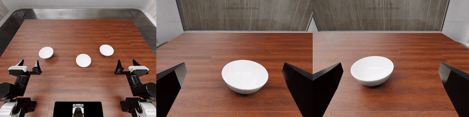

# CleanRUA (Clean Implementation of Robot-Use Agents)

CleanRUA has single-file implementations of robot-use agents for research. As in
[CleanRL](https://github.com/vwxyzjn/cleanrl), one file contains the whole agent, including prompt, tools and the interaction loop. The environments are plain Gymnasium environments.



### News
- **[2026/11/17]** Add hybrid control, where a vision-language model hands local phases to Pi0.5: [hybrid_robodojo.py](cleanrua/hybrid_robodojo.py).
- **[2026/11/16]** Add direct control, where a vision-language model moves the robot with motion tools: [direct_robodojo.py](cleanrua/direct_robodojo.py).

### Get started

Install the dependencies with the [installation guide](examples/installation.md), set the model, then run an agent:

```sh
export CLEANRUA_MODEL_NAME=YOUR_VISION_MODEL
export CLEANRUA_BASE_URL=https://YOUR_PROVIDER/v1
export CLEANRUA_API_KEY=YOUR_API_KEY
python -m cleanrua.direct_robodojo --native-root /path/to/RoboDojo --task stack_bowls
```

Tips:
1. To add a tool, write a `@Tool` method on the agent's wrapper. To change how the agent decides, edit its `RUAgent`.
2. Environments are plain `gym.Env`s and know nothing about tools or models. Each agent adds them with a `gym.Wrapper`.
3. Calling `finish` only ends the episode. Success is decided by the environment's own check.

### Algorithms implemented

| Algorithm | Description | Variants implemented |
|---|---|---|
| Direct control | A vision-language model moves the arms with motion tools. | [`direct_robodojo.py`](cleanrua/direct_robodojo.py) |
| Hybrid control | The model also hands local phases to Pi0.5, a vision-language-action model, and reviews each of its action chunks. | [`hybrid_robodojo.py`](cleanrua/hybrid_robodojo.py) |

### Cite Us

```bibtex
@misc{cleanrua2026yuan,
  title        = {CleanRUA: Clean Implementation of Robot-Use Agents},
  author       = {Mingqi Yuan, Xudong Wu, Jiayu Chen},
  year         = {2026},
  howpublished = {\url{https://github.com/friedrichyuan/CleanRUA}},
}
```

### Acknowledgements

CleanRUA is inspired by [CleanRL](https://github.com/vwxyzjn/cleanrl),
[RoboSimStudio](https://github.com/robosimstudio/robosimstudio) and
[uni-robot-agent](https://github.com/Open-RUA/uni-robot-agent). It uses
[RoboDojo](https://github.com/RoboDojo-Benchmark/RoboDojo) for simulation and
[XPolicyLab](https://github.com/XPolicyLab/XPolicyLab) for action models. We thank their authors.

### License

CleanRUA is released under the [MIT License](LICENSE).
