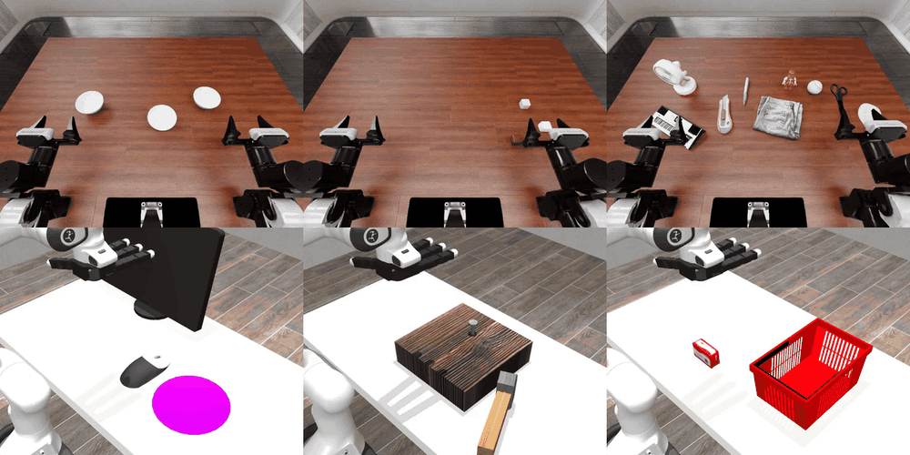

# CleanRUA

**Clean Implementations of Robot-Use Agents.**

Following the [CleanRL](https://github.com/vwxyzjn/cleanrl) design philosophy, CleanRUA provides single-file
implementations of robot-use agents for reproducible research. Each file contains a whole agent: its prompt, its
tools and the interaction loop. The environments are plain [Gymnasium](https://gymnasium.farama.org/)
environments.

{ width="100%" }

## Algorithms

CleanRUA groups agents by what the multimodal LLM (MLLM) sends to the robot each turn. Each paradigm is one file.

{ width="100%" }

| Algorithm | Description |
|---|---|
| [Direct](algorithms/direct.md) | An MLLM moves the arms with motion tools. |
| [Code](algorithms/code.md) | An MLLM writes Python programs that move the arms through a robot API. |
| [Delegate](algorithms/delegate.md) | An MLLM gives sub-task instructions to Pi0.5 and can also move the arms itself. |
| [Monitor](algorithms/monitor.md) | Pi0.5 does the task; an MLLM watches it and corrects failures with motion tools. |

## Quick start

Install the dependencies by following the [installation guide](get-started/installation.md). Then set the model
and run an agent:

```sh
export CLEANRUA_MODEL_NAME=YOUR_MODEL
export CLEANRUA_BASE_URL=https://YOUR_PROVIDER/v1
export CLEANRUA_API_KEY=YOUR_API_KEY
python -m cleanrua.direct_robodojo --native-root /path/to/RoboDojo --task stack_bowls
```

Each run writes TensorBoard scalars, `trajectory.jsonl`, the images shown to the model, videos and `result.json`
to `runs/<task>__<exp_name>__<seed>__<time>/`.

## News

- **2026/11/18**: Add `code_robodojo.py` and `monitor_robodojo.py`, and rename `hybrid_robodojo.py` to
  `delegate_robodojo.py`.
- **2026/11/17**: Add `hybrid_robodojo.py`, where an MLLM moves the robot with motion tools and gives sub-tasks
  to Pi0.5.
- **2026/11/16**: Add `direct_robodojo.py`, where an MLLM moves the robot with motion tools.

## Citation

```bibtex
@misc{cleanrua2026yuan,
  title        = {CleanRUA: Clean Implementations of Robot-Use Agents},
  author       = {Mingqi Yuan, Xudong Wu, Jiayu Chen},
  year         = {2026},
  howpublished = {\url{https://github.com/Agentic-Intelligence-Lab/CleanRUA}},
}
```

## Acknowledgements

CleanRUA is inspired by [CleanRL](https://github.com/vwxyzjn/cleanrl),
[RoboSimStudio](https://github.com/robosimstudio/robosimstudio) and
[uni-robot-agent](https://github.com/Open-RUA/uni-robot-agent). It uses
[RoboDojo](https://github.com/RoboDojo-Benchmark/RoboDojo) for simulation and
[XPolicyLab](https://github.com/XPolicyLab/XPolicyLab) for action models. We thank their authors.
